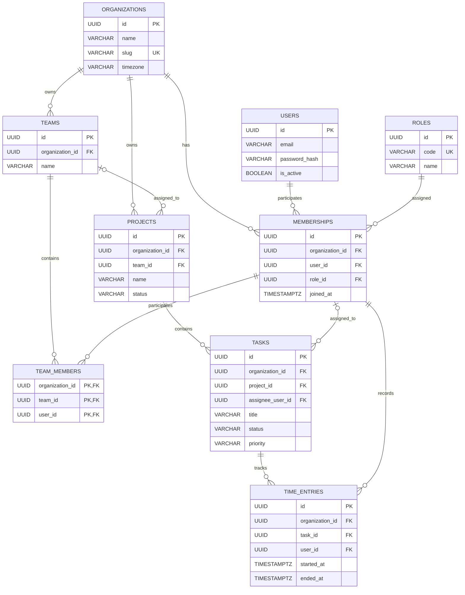

#Database Design

## Database Overview

Database engine, ORM, and a one-paragraph summary of the data domain.

## Er Diagram

# Model

## Table: `organizations`

## Purpose
Top-level tenant. Every team and membership belongs to exactly one organization, and organization membership is what scopes a user's access.

## Columns

| Column       | Type         | Nullable | Default | Description                                  |
|--------------|--------------|----------|---------|----------------------------------------------|
| `id`         | UUID         | No       |         | Unique organization identifier               |
| `name`       | VARCHAR(150) | No       |         | Display name                                 |
| `slug`       | VARCHAR(100) | No       |         | URL-safe unique identifier                   |
| `timezone`   | VARCHAR(100) | No       | `'UTC'` | Default timezone for the organization        |
| `created_at` | TIMESTAMPTZ  | No       | `NOW()` | When the organization was created            |
| `updated_at` | TIMESTAMPTZ  | No       | `NOW()` | When the organization was last modified      |

## Keys

**Primary key:** `(id)`

**Unique constraints:**
- `uq_organizations_slug` on `(slug)`: each slug identifies one organization.

## Relationships

No outgoing foreign keys.

**Referenced by:**
- `teams(organization_id)` via `fk_teams_organization`
- `memberships(organization_id)` via `fk_memberships_organization`

## Business rules

1. `slug` is unique across all organizations. Uniqueness is case-sensitive, so the application should normalize slugs (for example, lowercase) on write.
2. `name` is not unique. Two organizations may share a display name, and `slug` is the unique identifier.
3. `timezone` defaults to `'UTC'`. The schema does not validate it, so the application must only store valid IANA names (e.g. `Asia/Bangkok`).
4. An organization cannot be deleted while teams or memberships reference it (default `NO ACTION`). Child rows must be removed first, in order: `team_members`, then `teams` and `memberships`.
5. `updated_at` is not updated automatically. The application or a trigger must set it.

## Indexes

| Index                   | Columns  | Purpose                                       |
|-------------------------|----------|-----------------------------------------------|
| `uq_organizations_slug` | `(slug)` | Enforces unique slug and serves slug lookups  |

## Notes
- Slugs may change the meaning of URLs. Decide whether slugs are immutable or whether old slugs need redirects, and document it here.
- Slug format (allowed characters, reserved words like `admin` or `api`) is not enforced. Consider a `CHECK (slug ~ '^[a-z0-9-]+$')` if you want the database to guarantee it.
- Nothing enforces that an organization has at least one owner. That rule lives in application logic (see `roles`).
- No soft-delete column. If organizations should be deactivated rather than deleted, add something like `is_active` or `deleted_at`.

---
# Table: `users`

## Purpose
Global table of user accounts. Users are not tied to a single organization. Their organization access comes from `memberships`.

## Columns

| Column              | Type         | Nullable | Default | Description                                              |
|---------------------|--------------|----------|---------|----------------------------------------------------------|
| `id`                | UUID         | No       |         | Unique user identifier                                   |
| `email`             | VARCHAR(255) | No       |         | Login email, unique case-insensitively                   |
| `password_hash`     | VARCHAR(255) | Yes      |         | Hashed password. Null for users without a local password |
| `first_name`        | VARCHAR(100) | No       |         | Given name                                               |
| `last_name`         | VARCHAR(100) | No       |         | Family name                                              |
| `is_active`         | BOOLEAN      | No       | `TRUE`  | Whether the account may sign in                          |
| `email_verified_at` | TIMESTAMPTZ  | Yes      |         | When the email was verified. Null if not yet verified    |
| `created_at`        | TIMESTAMPTZ  | No       | `NOW()` | When the account was created                             |
| `updated_at`        | TIMESTAMPTZ  | No       | `NOW()` | When the account was last modified                       |

## Keys

**Primary key:** `(id)`

**Unique indexes:**
- `uq_users_email_lower` on `(LOWER(email))`: email addresses are unique regardless of case.

## Relationships

No outgoing foreign keys.

**Referenced by:**
- `memberships(user_id)` via `fk_memberships_user`

## Business rules

1. Email is unique case-insensitively. `Alice@x.com` and `alice@x.com` cannot both exist.
2. `password_hash` is nullable. A null value means the user has no local password (for example, invited but not yet set up, or signing in through an external provider). Confirm which applies and document it.
3. `email_verified_at` null means the email is unverified. Whether unverified users can sign in is an application rule, not enforced by the schema.
4. `is_active = FALSE` disables the account. The schema does not block anything by itself, so the application must check it at sign-in.
5. A user can belong to many organizations, with at most one membership in each (enforced in `memberships`).
6. A user cannot be deleted while memberships reference them (default `NO ACTION`). Deactivate with `is_active` instead.
7. `updated_at` is not updated automatically. The application or a trigger must set it.

## Indexes

| Index                  | Columns          | Purpose                                      |
|------------------------|------------------|----------------------------------------------|
| `uq_users_email_lower` | `(LOWER(email))` | Enforces unique email and serves login lookups |

## Notes
- The stored `email` keeps its original casing. Consider normalizing to lowercase on write, or switch to the `citext` type, so queries don't need `LOWER()`.
- No format check on `email`. Validation happens in the application.
- Never log or return `password_hash` in API responses. Say which hashing algorithm is used (e.g. argon2id, bcrypt) once decided.
- Users have no organization-scoped fields. Per-organization data such as role belongs on `memberships`.

---
# Table: `roles`

## Purpose
Global reference table of roles a user can hold within an organization. Roles are shared across all organizations (not tenant-scoped).

## Columns

| Column        | Type         | Nullable | Default | Description                                  |
|---------------|--------------|----------|---------|----------------------------------------------|
| `id`          | UUID         | No       |         | Unique role identifier                       |
| `code`        | VARCHAR(30)  | No       |         | Stable machine-readable code (e.g. `OWNER`)  |
| `name`        | VARCHAR(100) | No       |         | Human-readable display name                  |
| `description` | TEXT         | Yes      |         | What the role is for                         |

## Keys

**Primary key:** `(id)`

**Unique constraints:**
- `code` (unnamed, auto-generated as `roles_code_key`): each role code appears once.

## Relationships

No outgoing foreign keys.

**Referenced by:**
- `memberships(role_id)` via `fk_memberships_role`

## Seed data

| ID                                     | Code     | Name          | Description                  |
|----------------------------------------|----------|---------------|------------------------------|
| `00000000-0000-0000-0000-000000000001` | `OWNER`  | Owner         | Full organization ownership  |
| `00000000-0000-0000-0000-000000000002` | `ADMIN`  | Administrator | Organization administration  |
| `00000000-0000-0000-0000-000000000003` | `MEMBER` | Member        | Standard organization member |

The IDs are fixed and must not change, since application code may reference them directly.

## Business rules

1. Roles are global. Every organization uses the same set of roles.
2. `code` is unique and is the stable identifier for application logic. `name` is for display only and may change.
3. Every membership must have exactly one role (enforced from `memberships.role_id`).
4. A role cannot be deleted while memberships reference it. No `ON DELETE` action is defined on `fk_memberships_role`, so the default is `NO ACTION`.
5. The three seeded roles are managed through migrations, not at runtime.

## Notes
- The doc says what each role is for, but the schema does not enforce permissions. What `OWNER` or `ADMIN` can actually do lives in application code. Say so here, or link to where permissions are defined.
- Nothing enforces "each organization has at least one owner" or "only one owner". If either is intended, it needs application logic or a trigger. Document it as a rule once you decide.
- The migration should be idempotent, e.g. `ON CONFLICT (id) DO NOTHING`, so re-running it doesn't fail.

---
## Table: `memberships`

# Purpose
Records that a user belongs to an organization and which role they hold there.

## Columns

| Column            | Type        | Nullable | Default | Description                           |
|-------------------|-------------|----------|---------|---------------------------------------|
| `id`              | UUID        | No       |         | Unique membership identifier          |
| `organization_id` | UUID        | No       |         | Organization the user belongs to      |
| `user_id`         | UUID        | No       |         | Member user                           |
| `role_id`         | UUID        | No       |         | Role the user holds in the organization |
| `joined_at`       | TIMESTAMPTZ | No       | `NOW()` | When the user joined the organization |

## Keys

**Primary key:** `(id)`

**Unique constraints:**
- `uq_memberships_org_user` on `(organization_id, user_id)`: a user can have only one membership per organization. Also the target of `team_members(organization_id, user_id)`.
- `uq_memberships_org_id` on `(organization_id, id)`: redundant for uniqueness. Exists as a potential target for composite foreign keys from child tables.

## Relationships

| Constraint                     | Local columns       | References          | Meaning                                  |
|--------------------------------|---------------------|---------------------|------------------------------------------|
| `fk_memberships_organization`  | `(organization_id)` | `organizations(id)` | Membership belongs to one organization   |
| `fk_memberships_user`          | `(user_id)`         | `users(id)`         | Membership belongs to one user           |
| `fk_memberships_role`          | `(role_id)`         | `roles(id)`         | Membership has exactly one role          |

**Referenced by:**
- `team_members(organization_id, user_id)` via `fk_team_members_membership`

## Business rules

1. A user can have at most one membership per organization (`uq_memberships_org_user`).
2. Every membership has exactly one role. `role_id` is required.
3. A user must have a membership in an organization before joining any of its teams (enforced via `team_members`).
4. A membership cannot be deleted while `team_members` rows reference it. No `ON DELETE` action is defined, so the default is `NO ACTION`. Remove the user's team memberships first.
5. Deleting a user, organization, or role is blocked while memberships reference it (default `NO ACTION`).

## Indexes

| Index                   | Columns     | Purpose                                      |
|-------------------------|-------------|----------------------------------------------|
| `idx_memberships_user`  | `(user_id)` | "Which organizations does this user belong to?" |

`uq_memberships_org_user` already covers lookups by `(organization_id, user_id)` and by `organization_id` alone, so no extra index is needed for "list members of an org".

## Notes
- No `updated_at` column, so role changes are not timestamped. Add one, or an audit table, if you need role-change history.
  
---
# Table: `teams`

## Purpose
Groups of users within an organization.

## Columns

| Column            | Type         | Nullable | Default | Description                         |
|-------------------|--------------|----------|---------|-------------------------------------|
| `id`              | UUID         | No       |         | Unique team identifier              |
| `organization_id` | UUID         | No       |         | Organization that owns the team     |
| `name`            | VARCHAR(120) | No       |         | Team name                           |
| `description`     | TEXT         | Yes      |         | Optional free-text description      |
| `created_at`      | TIMESTAMPTZ  | No       | `NOW()` | When the team was created           |
| `updated_at`      | TIMESTAMPTZ  | No       | `NOW()` | When the team was last modified     |

## Keys

**Primary key:** `(id)`

**Unique constraints:**
- `uq_teams_org_id` on `(organization_id, id)`. Redundant for uniqueness, since `id` alone is already unique. It exists as the target for composite foreign keys such as `team_members(organization_id, team_id)`.

## Relationships

| Constraint              | Local columns       | References          | Meaning                              |
|-------------------------|---------------------|---------------------|--------------------------------------|
| `fk_teams_organization` | `(organization_id)` | `organizations(id)` | Every team belongs to one organization |

**Referenced by:**
- `team_members(organization_id, team_id)` via `fk_team_members_team`

## Business rules

1. Every team belongs to exactly one organization, and that cannot be null.
2. `(organization_id, id)` is unique so child tables can enforce that they belong to the same organization as the team.
3. A team cannot be deleted while `team_members` rows reference it. No `ON DELETE` action is defined, so the default is `NO ACTION`.
4. `updated_at` is not updated automatically. The application (or a trigger) must set it on change.

## Notes
- Team names are **not** unique within an organization. If that's intended, say so here. If not, add `UNIQUE (organization_id, name)`.
- Index suggestion: `(organization_id)` is covered by the unique constraint's leading column, so no extra index is needed for "list teams in an org" queries.

---
# Table: `team_members`

## Purpose
Join table recording which users belong to which teams within an organization.

## Columns

| Column            | Type        | Nullable | Default | Description                              |
|-------------------|-------------|----------|---------|------------------------------------------|
| `organization_id` | UUID        | No       |         | Organization that owns the team and user |
| `team_id`         | UUID        | No       |         | Team the user belongs to                 |
| `user_id`         | UUID        | No       |         | Member user                              |
| `joined_at`       | TIMESTAMPTZ | No       | `NOW()` | When the user joined the team            |

## Keys

**Primary key:** `(organization_id, team_id, user_id)`
A user can appear in a given team only once.

## Relationships

| Constraint                   | Local columns                | References                              | Meaning                                  |
|------------------------------|------------------------------|-----------------------------------------|------------------------------------------|
| `fk_team_members_team`       | `(organization_id, team_id)` | `teams(organization_id, id)`            | Each row belongs to one team in one org  |
| `fk_team_members_membership` | `(organization_id, user_id)` | `memberships(organization_id, user_id)` | Each row refers to a user's org membership |

Both foreign keys share `organization_id`.

## Business rules

1. A user can be on a team only once (enforced by the PK).
2. A user must already be a member of the organization before joining any of its teams (`fk_team_members_membership`).
3. A team and a user must belong to the **same organization**. Cross-organization team membership is impossible because both FKs use the same `organization_id`.
4. Removing a user's org membership or deleting a team is blocked while `team_members` rows reference it. No `ON DELETE` action is defined, so the default is `NO ACTION`. Remove the team memberships first.

## Notes
- Indexes: the PK covers lookups by `(organization_id, team_id)`. Consider an extra index on `(organization_id, user_id)` for "which teams is this user in?" queries.

---
# Table: `projects`

## Purpose
Units of work within an organization. A project belongs to one organization and may optionally be owned by one team in that organization.

## Columns

| Column            | Type         | Nullable | Default     | Description                                          |
|-------------------|--------------|----------|-------------|------------------------------------------------------|
| `id`              | UUID         | No       |             | Unique project identifier                            |
| `organization_id` | UUID         | No       |             | Organization that owns the project                   |
| `team_id`         | UUID         | Yes      |             | Team responsible for the project. Null if unassigned |
| `name`            | VARCHAR(150) | No       |             | Project name                                         |
| `description`     | TEXT         | Yes      |             | Optional free-text description                       |
| `status`          | VARCHAR(30)  | No       | `'PLANNED'` | Lifecycle status (see Business rules)                |
| `start_date`      | DATE         | Yes      |             | Planned start date                                   |
| `due_date`        | DATE         | Yes      |             | Planned due date                                     |
| `created_at`      | TIMESTAMPTZ  | No       | `NOW()`     | When the project was created                         |
| `updated_at`      | TIMESTAMPTZ  | No       | `NOW()`     | When the project was last modified                   |

## Keys

**Primary key:** `(id)`

**Unique constraints:**
- `uq_projects_org_id` on `(organization_id, id)`: redundant for uniqueness. Exists as a target for composite foreign keys from child tables.

## Relationships

| Constraint                | Local columns                | References                   | Meaning                                                  |
|---------------------------|------------------------------|------------------------------|----------------------------------------------------------|
| `fk_projects_organization`| `(organization_id)`          | `organizations(id)`          | Project belongs to one organization                      |
| `fk_projects_team`        | `(organization_id, team_id)` | `teams(organization_id, id)` | Optional team owner, which must be in the same organization |

**Referenced by:**
- None among the tables documented so far.

## Business rules

1. Every project belongs to exactly one organization.
2. A project may have no team (`team_id` is null). If a team is set, it must belong to the same organization as the project.
3. `status` must be one of `PLANNED`, `ACTIVE`, `COMPLETED`, `ARCHIVED` (`chk_projects_status`). New projects start as `PLANNED`.
4. If both dates are set, `due_date` must be on or after `start_date` (`chk_projects_dates`). Either date may be null.
5. Allowed status transitions (for example, whether `ARCHIVED` can return to `ACTIVE`) are not enforced by the schema. Document them if the application restricts them.
6. A team cannot be deleted while projects reference it (default `NO ACTION`). Reassign or clear `team_id` first.
7. An organization cannot be deleted while projects reference it (default `NO ACTION`).
8. `updated_at` is not updated automatically. The application or a trigger must set it.

## Indexes

| Index                    | Columns                      | Purpose                                           |
|--------------------------|------------------------------|---------------------------------------------------|
| `idx_projects_org_status`| `(organization_id, status)`  | "List an organization's projects by status"       |
| `uq_projects_org_id`     | `(organization_id, id)`      | Composite FK target. Also serves org-scoped lookups |

## Notes
- No index on `(organization_id, team_id)`. If you list projects by team, or delete teams often, add one. Postgres does not index FK columns automatically, and the FK check on team deletion scans `projects`.
- Status values are a `CHECK` list, not a lookup table. Adding a status requires a migration that changes the constraint.
- Project membership is not modeled. Access is implied by organization membership and the optional team. Say so here if that is intentional.
- Add `ON DELETE SET NULL (team_id)` (Postgres 15+) if you want deleting a team to clear the project's team without nulling `organization_id`. Plain `SET NULL` would try to null both columns and fail.
- No soft-delete column. `ARCHIVED` status serves as the archive state.

---
# Table: `tasks`

## Purpose
Units of work within a project. A task belongs to one project and may be assigned to one member of the organization.

## Columns

| Column              | Type         | Nullable | Default    | Description                                            |
|---------------------|--------------|----------|------------|--------------------------------------------------------|
| `id`                | UUID         | No       |            | Unique task identifier                                 |
| `organization_id`   | UUID         | No       |            | Organization that owns the task                        |
| `project_id`        | UUID         | No       |            | Project the task belongs to                            |
| `assignee_user_id`  | UUID         | Yes      |            | User responsible for the task. Null if unassigned      |
| `title`             | VARCHAR(200) | No       |            | Short task title                                       |
| `description`       | TEXT         | Yes      |            | Optional free-text description                         |
| `status`            | VARCHAR(30)  | No       | `'TODO'`   | Workflow status (see Business rules)                   |
| `priority`          | VARCHAR(20)  | No       | `'MEDIUM'` | Priority level (see Business rules)                    |
| `estimated_minutes` | INTEGER      | Yes      |            | Estimated effort in minutes                            |
| `due_at`            | TIMESTAMPTZ  | Yes      |            | Deadline                                               |
| `created_at`        | TIMESTAMPTZ  | No       | `NOW()`    | When the task was created                              |
| `updated_at`        | TIMESTAMPTZ  | No       | `NOW()`    | When the task was last modified                        |

## Keys

**Primary key:** `(id)`

**Unique constraints:**
- `uq_tasks_org_id` on `(organization_id, id)`: redundant for uniqueness. It is the target of `time_entries(organization_id, task_id)`.

## Relationships

| Constraint            | Local columns                         | References                              | Meaning                                                          |
|-----------------------|---------------------------------------|-----------------------------------------|------------------------------------------------------------------|
| `fk_tasks_project`    | `(organization_id, project_id)`       | `projects(organization_id, id)`         | Task belongs to a project in the same organization               |
| `fk_tasks_assignee`   | `(organization_id, assignee_user_id)` | `memberships(organization_id, user_id)` | Optional assignee, who must be a member of the same organization |

**Referenced by:**
- `time_entries(organization_id, task_id)` via `fk_time_entries_task`

## Business rules

1. A task belongs to exactly one project, and the project must be in the same organization as the task.
2. A task may be unassigned (`assignee_user_id` is null). If set, the assignee must be a member of the task's

---
# Table: `time_entries`

## Purpose
Records time a user spent working on a task. An entry with no `ended_at` is a running timer.

## Columns

| Column            | Type        | Nullable | Default | Description                                         |
|-------------------|-------------|----------|---------|-----------------------------------------------------|
| `id`              | UUID        | No       |         | Unique time entry identifier                        |
| `organization_id` | UUID        | No       |         | Organization that owns the task and the user's membership |
| `task_id`         | UUID        | No       |         | Task the time was logged against                    |
| `user_id`         | UUID        | No       |         | User who logged the time                            |
| `started_at`      | TIMESTAMPTZ | No       |         | When work started                                   |
| `ended_at`        | TIMESTAMPTZ | Yes      |         | When work ended. Null while the timer is running    |
| `description`     | TEXT        | Yes      |         | Optional note about the work done                   |
| `is_billable`     | BOOLEAN     | No       | `FALSE` | Whether the time is billable                        |
| `created_at`      | TIMESTAMPTZ | No       | `NOW()` | When the entry was created                          |
| `updated_at`      | TIMESTAMPTZ | No       | `NOW()` | When the entry was last modified                    |

## Keys

**Primary key:** `(id)`

## Relationships

| Constraint                    | Local columns                | References                              | Meaning                                              |
|-------------------------------|------------------------------|-----------------------------------------|------------------------------------------------------|
| `fk_time_entries_task`        | `(organization_id, task_id)` | `tasks(organization_id, id)`            | Entry belongs to a task in the same organization     |
| `fk_time_entries_membership`  | `(organization_id, user_id)` | `memberships(organization_id, user_id)` | Entry belongs to a user who is a member of that organization |

Both foreign keys share `organization_id`.

**Referenced by:**
- None among the tables documented so far.

## Business rules

1. A time entry belongs to one task and one user, and both must be in the same organization (enforced by the shared `organization_id`).
2. The user must be a member of the organization. Cross-organization time logging is impossible.
3. `ended_at` null means the entry is still running. If set, it must be on or after `started_at` (`chk_time_entries_duration`).
4. Duration is not stored. It is calculated as `ended_at - started_at`.
5. `is_billable` defaults to `FALSE`. Billable time must be marked explicitly.
6. A user can have at most one running timer (`ended_at IS NULL`) per organization (`uq_time_entries_active_timer`). Starting a new timer while one is running fails with a unique violation, so the application must stop the running timer first. Overlapping entries that have both `started_at` and `ended_at` set are still not prevented by the schema.7. A task cannot be deleted, and a membership cannot be removed, while time entries reference them (default `NO ACTION`).
8. `updated_at` is not updated automatically. The application or a trigger must set it.

## Indexes

| Index                          | Columns                      | Purpose                                      |
|--------------------------------|------------------------------|----------------------------------------------|
| `idx_time_entries_org_task`    | `(organization_id, task_id)` | "Time logged on a task". Also serves the FK check when a task is deleted |
| `idx_time_entries_org_user`    | `(organization_id, user_id)` | "Time logged by a user". Also serves the FK check when a membership is deleted |
| `idx_time_entries_started_at`  | `(started_at)`               | Date-range queries across all organizations  |
| `uq_time_entries_active_timer` | `(organization_id, user_id) WHERE ended_at IS NULL` | Enforces one running timer per user per organization. Also serves "find this user's running timer" |

## Notes
- `idx_time_entries_started_at` has no `organization_id`, so a per-tenant date-range query (the common case) can't use it efficiently. Consider `(organization_id, started_at)` instead.
- To enforce one running timer per user, add a partial unique index: `CREATE UNIQUE INDEX uq_time_entries_running ON time_entries (organization_id, user_id) WHERE ended_at IS NULL;`
- To prevent overlapping entries per user, use an exclusion constraint with `tstzrange(started_at, ended_at)` (requires the `btree_gist` extension). Skip it if overlaps are allowed.
- The task's project is reachable through `tasks`. Reports by project need a join.
- Rows are not tied to the task's assignee. Anyone in the organization can log time on any task unless the application restricts it.

## Migrations
How to create and run migrations, plus the naming convention.
